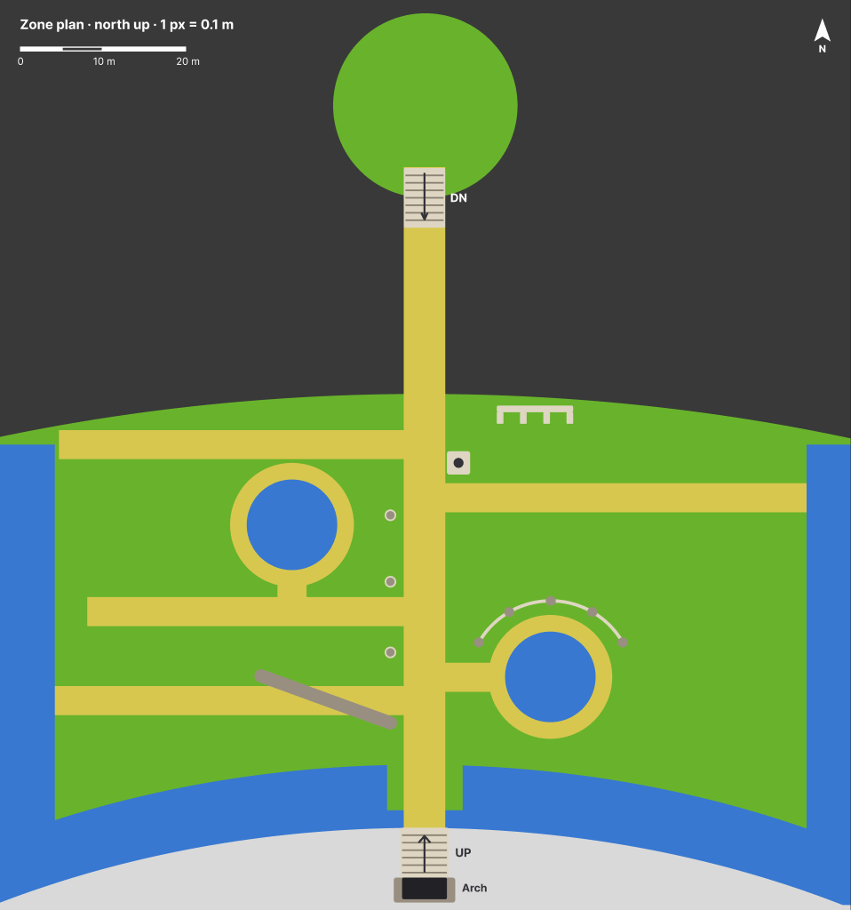

# Sky Garden Ruins — 3D Scene Design Plan

Andrew Berg · last updated Nov 1, 2026 · [live doc](https://claude.ai/artifact/RUJUMzjQAacZbNG9dTQKwQ)

## Overview

The goal is a small playable 3D level: an overgrown classical garden in a floating city that the player explores with a character and a third-person follow camera. Stone ruins are swallowed by lawn, shrubs and water, and the whole thing should look hand-painted rather than photoreal.

What the three references establish (an overhead view, a ground-level view looking south from the north edge, and a very high view looking east):

- **Viewpoint:** the screenshot's high oblique view is a layout and mood reference only. In play, the camera sits 8 to 10 m behind the robot at roughly its head height (about 4 m), so every element must hold up from ground level and from all sides.
- **Story:** a formal garden plan (paths, pools, colonnades) that nature has reclaimed. Order underneath, softness on top.
- **Mood:** calm, sunlit, quiet. Saturated greens, warm sandstone, deep blue-green water, no harsh shadows.
- **Boundaries:** the south is the base of the city itself: tiered, curving stone buildings several times taller than the columns, with a rounded bastion section, all fronted by a moat. Moat strips run down the west and east sides, containing the player as in the source material. The north side is a sheer masonry face dropping into the sky, and the garden is a curved terrace on the city's north flank, its north edge bowing out over the drop.

Scope: one walkable garden of roughly 100 x 55 m including the moats, curved to follow the city, with the robot as a controllable character, a follow camera, collision and clear edges. The path arrives from a freestanding tower, down a short stair and over a narrow causeway across the drop and ends at a stair climbing into a stone arch at the foot of the city, the level's visual destination.

For now the level is purely exploratory: no objective, timer or HUD. The player walks the garden, steps over ruins and shoves the stonework around, and the arch stays sealed until an objective is chosen.

## Layout

One straight paved axis runs the whole level, from a stair off the start platform, across the causeway and the garden, to a stair up into the arch. The [Figma zone plan](https://www.figma.com/design/VHkN104QEH1hj0NNXPZUnq/Untitled?node-id=0-1) is the source of truth for where things go; the image below is a snapshot of it. It is drawn at 1 px = 0.1 m with a scale bar, and the sizes in the asset list are measured from it.

- **Arrival:** the player starts on the round platform, takes a short stair down onto the causeway, and crosses the drop straight onto the grass. The arch is dead centre at the far end of the path from the first step.
- **Garden shape:** a curved terrace. The north edge bows out over the drop with no railing; the south edge follows the curve of the city's base.
- **Branch paths:** three to the west and one to the east, staggered rather than lined up, so the garden reads as informal rooms off the main axis.
- **West of the path:** a pool reached by a short stub from the middle west branch; three standing columns in a row beside the main path; and the fallen column lying across the lowest west branch. The column is a deliberate obstacle: at about the robot's knee height, the robot steps over it or shoves it out of the way.
- **East of the path:** the statue on its plinth near the north end, the low arch ruin by the north edge, and the east pool joined to the main path by a short stub, with the colonnade arcing round its north side.
- **South end:** a grass landing pushes into the moat on either side of the path, so the last crossing is short. The path then climbs a stair into the arch at the base of the city. The arch stays sealed for now: it is the destination the whole path points at, ready for an objective later.
- **Edges:** moat strips down the west and east sides contain the player, matching the source material; the south moat follows the city's curve. The north edge has no visible railing, just an invisible wall 1 m back from the lip.
- **Spacing:** keep 5 m clear between colliders on any route so the follow camera never gets pinned.

## Level flow

- **Start:** the level opens on a camera fly-in. The camera starts high above the drop north of the platform, looking south across the whole garden to the city, then descends along the main axis and settles behind the robot on the platform in about 6 s, eased in and out. Any key or click skips it, and control begins when it lands.
- **Play:** free exploration, with no objective, timer or HUD for now.
- **Arch:** sealed, as the visual destination. Its unlock comes with a future objective.
- **Pause:** Esc opens a small menu: resume, reset the stonework, mouse sensitivity.

## Asset list

About 22 stone, water and ground assets build the level, plus about 11 vegetation types; most of the scene count comes from instancing shrubs, trees and stone debris. Sizes are set against the robot at about 4 m tall, so a 14 m column is roughly three and a half robots high.

| Asset | Approx. size | Count | Collision | Notes |
| --- | --- | --- | --- | --- |
| City façade (south backdrop) | About 100 m wide, 65 to 95 m tall | 1 | Fixed box at the base only | Curving tiers with rows of small arched windows, rust bands between tiers, grass and trees on the ledges, a small domed turret. Low-poly with painted texture; only the bottom 10 m needs detail. |
| Rounded bastion | 25 to 30 m dia | 1 | Fixed cylinder | Round, tiered section of the city's base beside the arch, moat at its foot. |
| Stone arch and stair up | Arch about 7 m wide, 10 m tall; stair about 6 m wide, 6 m long | 1 | Fixed box piers, ramp collider on the stair | The visual destination at the end of the main path. Sealed for now; an unlock comes with a later objective. Dark interior; the most detailed stonework in the level. |
| Start platform | About 22 m dia | 1 | Fixed walkable top, invisible edge walls | The round, grassy top of the freestanding tower where the robot spawns and the fly-in lands. |
| Stair down from platform | 5 m wide, about 7 m long, 8 steps | 1 | Fixed ramp collider | Leads off the platform's south edge onto the causeway. |
| Causeway | 5 m wide, about 20 m long | 1 | Fixed deck + invisible side walls | Masonry sides, no railing. |
| Moat strips | About 7 m wide | 3 (west, east, curved south) | Invisible wall at the water's edge | The level's boundary on three sides. |
| Grass landing | About 9 x 7 m | 1 | Ground | Pushes into the south moat either side of the path, shortening the last crossing. |
| North cliff face | Full width, drops out of sight | 1 | Invisible wall 1 m back from the lip | Same blocky masonry as the garden sides; fades into fog below. No railing. |
| Lawn terrace | About 90 x 45 m, curved | 1 | Ground | North edge bows out over the drop; south edge follows the city. |
| Paved paths | Main axis 5 m; branches 3.5 m | 1 axis + 4 branches | Part of ground | Three branches west and one east, staggered. Large pale flagstones. |
| Standing column | 1.4 m dia, about 14 m tall | 3 | Dynamic compound (base, shaft, capital), very heavy | In a row beside the main path, west side, about 8 m apart. Topples after a few seconds of pushing. |
| Fallen column | 1.4 m dia, about 18 m long | 1 | Dynamic, 3 to 4 drum segments | Lies across the lowest west branch. The robot steps over it or shoves it aside. |
| Loose column drum | 1.4 m dia, 1 to 1.5 m long | 3 to 4 | Dynamic cylinder | Near the fallen column; rolls easily. Reuse the column shaft. |
| Urn or planter | 1 to 1.5 m tall | 4 to 6 | Dynamic convex hull | Beside the pools; tips over when pushed. |
| Statue on plinth | Plinth about 3 m, figure 3 m | 1 | Dynamic: plinth box and figure hull, separate bodies | Near the north end, east of the path. A generic robed figure with a raised arm; weathered and mossy. |
| Low arch ruin | About 9 m long, 2.5 m tall | 1 | Dynamic: one box per pier and lintel piece | Broken arcade near the north edge, east side; comes apart when knocked. |
| Round pool with stone rim | About 15 m across the rim, 11 m of water | 2 | Fixed rim as a low wall; invisible wall over the water | Upper west and lower east, each joined to a path by a short stub. |
| Semicircular colonnade | About 20 m span, 6.5 m tall | 1 | Dynamic: one body per column, lintel in segments | Arcs round the north side of the east pool; collapses piece by piece. |
| Stone slabs and blocks | 1 to 3 m | 10 to 20 | Dynamic box, or fixed if flush with the ground | Scatter along path edges; vary rotation. |
| Sky backdrop | Skybox + distant cards | 1 | None | Clouds below the north edge and around the causeway. |

Trees, shrubs and ground cover have their own section below.

## Vegetation

The garden should read as a formal plan that nature is slowly taking back: paths, pools and columns stay legible, while plants press in from the edges and creep over every stone. Planting is densest along the moats and thins toward the main path.

| Asset | Variants | Approx. size | Count | Where | Collision | Notes |
| --- | --- | --- | --- | --- | --- | --- |
| Large canopy tree | 2 | 20 to 30 m tall, 15 to 25 m crown | 3 to 5 | Garden corners and along the moats; one leaning out over the north edge | Capsule on trunk | Broad, soft crowns that throw big patches of shade. More grow on the city's tiers as backdrop. |
| Small ornamental tree | 2 | 6 to 10 m tall | 6 to 10 | Beside the pools and at the ends of branch paths | Capsule on trunk | Gives each garden room its own focal point. |
| Conical cypress | 2 | 5 to 12 m tall | 15 to 25 | Loose rows along the branch paths; a pair framing the approach to the arch | Capsule on trunk | Dark blue-green; the vertical accent among the rounded shapes. |
| Shrub mass | 3 sizes | 1 to 4 m | 80 to 150 | Heaped against the moat strips, around column bases and between branch paths | Sphere on the largest only | Rounded clumps, two-tone with a bright sunlit rim. Most sit around the robot's knee to waist height. |
| Overgrown hedge fragment | 2 | 1.5 to 2.5 m tall, 5 to 10 m long | 6 to 10 | Old edging along the paths, broken and gappy | Box | Remnants of the original formal design. |
| Ivy sheet | 4 to 6 cards | Varies | Many | Wrapping one column completely; on the arch, city base, pool rims and causeway sides | None | Alpha cards hugging the stonework. |
| Flowering vine | 2 | Varies | 4 to 6 clusters | Spilling over the north edge, the start platform and the low arch ruin | None | White blossoms, as in the first reference. |
| Tall grass and wildflowers | 3 | 0.5 to 1.2 m | Scattered patches | Where paths meet lawn, around the ruin and the fallen column | None | Sways in the wind; small dots of white, pink and yellow. |
| Grass in paving | Decal + tufts | Ground level | Along all paths | Cracks and edges of the flagstones | None | Breaks up the clean path edges without narrowing them. |
| Moss | Decal | Surface | Many | Ledges, slab tops, the fallen column, the statue | None | Painted into stone textures where possible. |
| Water lilies and petals | 2 | Floating | Clusters | Pools and the quieter moat stretches | None | White petals drift on the dark water. |

**Placement rules**

- Keep the main path and branch paths clear for the camera (5 m), but let grass, flowers and moss creep over their edges.
- Layer three heights everywhere: ground cover, shrubs, then trees, so silhouettes never read as a flat lawn with props.
- Never block the view of the arch from the start platform; use trees to frame it instead.
- Let foliage swallow the ruins: shrubs at the column bases, grass through the fallen column, ivy on the statue.
- One shared wind shader for all foliage, slower and broader on the trees.
- Instance everything, with random scale of plus or minus 20% and random rotation per instance, so 2 to 3 mesh variants per type are enough.

## Look development

The painted look comes from three things: flat, hand-tuned colour instead of physically based detail; soft clumped foliage instead of individual leaves; and atmosphere that fades distance toward sky blue. Get those right before adding detail.

**Palette (starting values, tune by eye)**

| Role | Colour | Notes |
| --- | --- | --- |
| Lawn, lit | #8DBF4A | Warm yellow-green. |
| Lawn, shade | #4F7F3A | Shift toward blue-green, never toward grey. |
| Shrubs and trees | #3E7A3C to #6FA64A | Two-tone with a bright rim on the sunny side. |
| Stone, lit | #E6D8BC | Warm cream, almost white in full sun. |
| Stone, shade | #9497C4 | Cool lavender-blue; the second reference's shadows lean violet, not grey. |
| Stone bands and roofs | #B47A45 | Rust-ochre bands between the city's tiers and on the turret dome. |
| Moss on stone | #6E8F3E | Painted into ledges and the upper faces of stones. |
| Path paving | #D8C8A0 | Pale stone, lighter than the lawn. |
| Water | #2E4A66 to #3E6A80 | Dark blue, flecked with white petals. |
| Sky / fog | #A9D2E8 | Same colour for fog so distance melts into sky. |

**Materials**

- Toon or stepped-diffuse shading with 2 to 3 soft bands, plus a gentle rim light. Avoid hard cel lines; no outlines.
- Stone: hand-painted albedo with baked ambient occlusion and drip and moss streaks. Low roughness variation, no normal-map grit.
- Foliage: clumped low-poly blobs with normals transferred from a sphere, so they shade as soft masses. Alpha-card leaves on the silhouette edge only.
- Grass: a vertex-shader grass field with wind sway near the player, fading to a painted texture beyond about 35 m.
- Water: flat plane with a sky-and-tree reflection, a slight depth darkening and small floating white specks (petals) as in the reference.

**Lighting**

- One warm directional sun, high and from behind the camera's usual direction, plus a cool sky-blue hemisphere fill.
- Soft shadows only; shadow colour tinted blue-green rather than black.
- Baked AO on static stonework; real-time shadows on the character and nearby foliage only.

**Post-processing**

- Height and distance fog in the sky colour.
- Light bloom on sunlit stone and water highlights.
- A subtle paper or brush-texture overlay and slight saturation boost to finish the painted feel. Keep it light so motion stays readable.

## Technical approach

Stack: a web build in plain three.js with Rapier physics (@dimforge/rapier3d-compat), models made in Blender and exported as glTF. React Three Fiber is optional, worth it only if you already work in React. Rapier stays for its character controller, which handles stairs, slopes and collisions with the stonework.

**Conventions**

- 1 unit = 1 metre, Y up. North is −Z, south (toward the arch) is +Z, east is +X. The origin sits where the main path meets the garden's north edge.
- Models export as glTF binary (.glb) with meshopt or Draco compression and KTX2 textures. Apply transforms before export; props pivot at the centre of their base.
- Colliders are hidden meshes named with a `_col` suffix, or built in code. Movable objects are tagged `_dyn`.
- Physics: gravity 9.81 m/s², fixed 60 Hz step.

**Player character**

The player is a tall, weathered garden robot, based on the front, side and three-quarter reference sheet supplied for it. What that reference sets for the build:

- **Silhouette:** a small round head on a short neck, a wide rounded torso, a narrow waist, and very long segmented arms whose hands hang almost to the ankles. The legs are short next to the arms.
- **Surface:** brown-bronze metal, matte and worn, with moss and a few small plants growing on the shoulders and head, so the robot looks like part of the overgrown garden.
- **Movement:** slow, heavy and very strong: it can shove any stone object in the garden. Long arms swing from the shoulder.
- **Scale:** about 4 m tall, read from two references. In the close shot the robot is roughly three times the height of the two children on the path, with its hands hanging near its ankles. In the overhead shot it stands about a quarter to a third of a column's height, so the columns are about 14 m. Every size in this doc is set to that scale.
- **Model:** built by the implementer in Blender from the reference sheet. The limbs are stacks of rigid segments, so parent each segment to a bone instead of skinning it; that keeps the rig simple and the joints clean. Export as a rigged glTF with embedded animations, under about 20k triangles, one 2k painted texture, pivot at the feet, facing −Z.
- **Animations:** idle, walk, run, turn in place, push (blended over walk when pressing into stone) and step-over. No jump.

**Character and controls**

- Kinematic capsule character, about 4 m tall with a 0.8 m radius, using Rapier's character controller: walk, run and step-over, no jump. Slope limit around 40 degrees; auto-step 0.5 m so stairs, rims and low slabs need no special move.
- Step-over: walking into an obstacle between 0.5 m and about 1.6 m tall, and no more than about 2.5 m deep, triggers it. The robot lifts its legs over in about 1.5 s while the controller carries it across on a short arc, then control resumes. It covers the fallen column, toppled columns and drums, slabs on edge and low hedge fragments.
- Speeds: walk about 1.6 m/s, run about 3 m/s. Heavy acceleration (about 0.4 s to full speed) and smoothed turning sell the robot's weight.
- Camera-relative movement: input is rotated by the camera's yaw so "forward" always means away from the camera.
- Controls, keyboard and mouse first: WASD to move, Shift to run, mouse to orbit (pointer lock on click), wheel to zoom within limits, R to reset the stonework, Esc to pause. Gamepad as an extra: left stick to move, right stick for the camera, Y to reset.
- Stairs: Rapier's controller with autostep (max step about 0.5 m, min width 0.3 m; build risers at 0.4 m or less) and snap-to-ground, so the robot walks up the platform stair and the arch stair without bouncing. If any step feels sticky, give that stair an invisible ramp collider under the visible steps.

**Follow camera**

- Orbit around a pivot at the character's shoulder, about 8 to 10 m back and 2.5 m above, so the whole 4 m robot stays in frame, with mouse or right-stick orbit and pitch from about 20 degrees up to 60 degrees down, so the player can look up at the city façade.
- Spring-damped position so the camera lags slightly behind turns.
- Collision avoidance: a sphere cast from pivot to camera pulls the camera in when columns, the colonnade or trees get between. Set foliage to a layer the cast ignores, and fade or dither shrubs that block the view instead of snapping the camera in.
- Near the north edge, let the camera swing out over the drop rather than pushing in.

**Collision and boundaries**

- Simple primitives only (boxes, capsules, cylinders) authored as separate hidden meshes or generated in code; never trimesh colliders on detailed stone.
- Terrain as a heightfield or a single low-poly trimesh.
- Edges: the west, east and south moats are the boundary, as invisible walls at the water's edge, and the city base behind the south moat is a solid collider. The north edge has no railing: an invisible wall 1 m back from the lip, plus a fall-off reset below the level in case anything gets past it.
- Water: blocked. Invisible walls follow the water's edge on the moats and pools, so the player can never enter the water and needs no respawn.

**Movable objects**

- Every freestanding stone object in the garden is a dynamic Rapier body: the standing columns, the fallen column and loose drums, the statue and its plinth, the low arch ruin, the colonnade's columns and lintel, the slabs and blocks, and the urns. Built architecture stays fixed: the city, bastion, arch and stairs, start platform, causeway, pool rims and paths.
- A kinematic controller doesn't push bodies by itself. Each frame, read the controller's collisions and apply an impulse to every dynamic body the robot touches, scaled by its speed and direction.
- Use realistic stone density (about 2,400 kg/m³) and tune the push so light things react at once and heavy things take effort: urns tip and drums roll straight away, slabs slide, and a 14 m column rocks and topples after a few seconds of steady pushing. High angular damping stops toppled pieces rolling forever.
- Multi-part objects (colonnade, ruin, statue on plinth) are separate bodies stacked at rest, so they come apart when knocked. Ivy and moss on a stone move with it.
- About 40 to 60 dynamic bodies in total, all asleep until touched.
- The invisible walls at the water's edge also stop objects. Anything shoved past the north edge falls away and is removed once it drops below the level.
- R (or Reset in the pause menu) returns every stone object to its starting place, since the garden will get messy.

**Performance budget (mid-range laptop, 60 fps)**

- Under 150 draw calls: instance shrubs, trees, slabs and column drums. Physics: 40 to 60 dynamic bodies, asleep until touched, under 2 ms per step.
- Around 300k to 500k triangles on screen; foliage LODs at 25 m and 60 m.
- One shadow-casting light with a tight shadow camera that follows the player.
- Textures: 1k to 2k painted atlases, compressed with KTX2. The city façade gets its own 4k painted texture on simple geometry, since it fills half the screen when facing south.

## Build order

Movement and camera come first, because the level's scale and spacing depend on how it feels to walk through it.

1. **Playable greybox.** Flat ground, the 4 m capsule, follow camera with collision. Done when walking, running and orbiting feel right at the speeds above, and the camera never clips through a test column.
2. **Blockout.** Every asset as a grey primitive at final size, placed from the Figma plan at 1 px = 0.1 m, from the start platform to the arch. Done when you can walk the whole route, every landmark is visible from the causeway, and no route is narrower than 5 m.
3. **Collision and boundaries.** Final colliders, invisible walls at the water and the north edge, the fall-off reset. Done when the robot cannot leave the level or enter water, never snags on an edge, and climbs both stairs smoothly.
4. **Pushing and step-over.** Every freestanding stone object as a dynamic body, push impulses from the robot, step-over, R to reset. Done when the robot can topple a column without jitter or launching it, steps over the fallen column and any toppled column, and R restores the garden.
5. **Robot model.** Model, rig and animate the robot, then swap it in for the capsule. Done when animation speed matches movement with no foot sliding, push and step-over blend cleanly, and it stays within the model budget.
6. **Lighting and fog.** Sun, sky fill, fog and palette applied to the greybox. Done when the view from the causeway and from the south end matches the references' mood.
7. **Hero stone assets.** City façade and bastion, arch and stairs, platform and causeway, columns, colonnade, pools, statue, ruin, urns; painted textures and moss.
8. **Foliage.** Trees, cypress, shrubs and hedge fragments instanced; grass field; ivy and vines. Done when the placement rules hold and the arch is still visible from the platform.
9. **Water and detail.** Water shader, lilies and petals, slabs, path decals.
10. **Start and polish.** Camera fly-in, pause menu, post-processing, foliage fade near the camera, wind, ambient sound, performance pass. Done when the fly-in lands cleanly behind the robot and the level holds 60 fps on the target laptop under 150 draw calls.

## Open questions

- [ ] Objective: none for now, so the level ships as an exploration space. When one is chosen, it decides how the arch unlocks.
